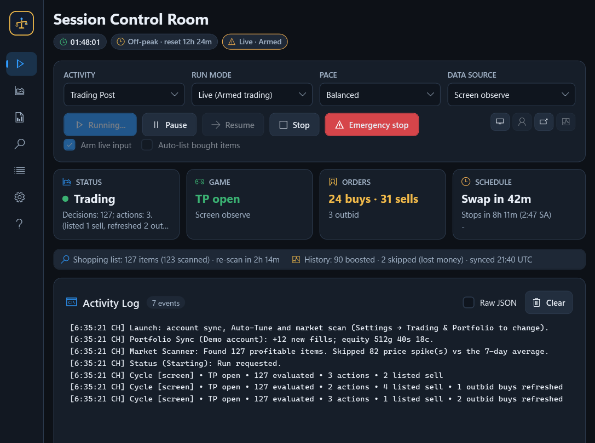
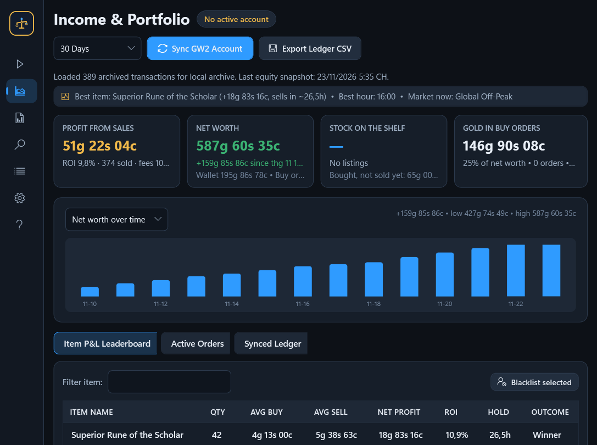
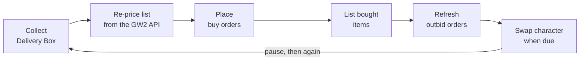

# Mmopal

**A Guild Wars 2 Trading Post companion for Windows.** It finds items worth flipping, places and refreshes buy orders,
lists what fills, and shows what you really earned after fees.

| Run a session | See what it earned |
| --- | --- |
|  |  |

<sub>The real app with demo data.</sub>

## What one cycle does



A worked flip, with the Trading Post's 15% fees:

| Buy order | Listed at | Listing fee 5% | Exchange fee 10% | You keep |
| --- | --- | --- | --- | --- |
| 1g 00s | 1g 30s | −6s 50c | −13s | **+10s 50c (10.5%)** |

## Quick start

You need Windows 10/11 at 100% display scaling, the [.NET 10 SDK](https://dotnet.microsoft.com/download) and a
[GW2 API key](https://account.arena.net/applications) with `account`, `tradingpost`, `wallet`, `inventories` and
`characters`.

```powershell
dotnet run --project src/Mmopal.Desktop/Mmopal.Desktop.csproj
```

1. **Settings → Accounts & API:** add your key. It is stored encrypted on this PC only.
2. **Market Scanner:** pick a preset, **Scan GW2 Market**, then **Use All for Session**.
3. **Session:** press **Start session**. It starts in **Dry run**, so nothing touches the game.

Ready for the real thing? [Going live](docs/run.md#going-live) covers the in-game settings.

## Which mode does what

| Mode | Reads the game | Decides | Clicks and types |
| --- | :---: | :---: | :---: |
| **Dry run** | optional | ✓ | – |
| **Observe only** | ✓ | ✓ | – |
| **Live** (only while **Arm live input** is ticked) | ✓ | ✓ | ✓ |

## What keeps your gold safe

| Risk | What Mmopal does |
| --- | --- |
| Wrong item opened | Reads the item window's title; if it cannot prove the item, it does not order. |
| Wrong price or quantity | Types the price only after reading the live one, and confirms it on the dialog's Total before the last click. |
| Selling your own things | Lists, relists and cancels only units and orders it created itself. |
| Selling at a loss | Holds an item until the price covers what was paid plus fees. |
| All gold in orders | At most 50% of your gold in buy orders, plus a reserve it never touches. |
| Something looks off | **Ctrl+Shift+P** pauses, **Ctrl+Shift+S** stops, **Ctrl+Shift+X** stops at once. |

> Automating game input can break ArenaNet's rules and put an account at risk. Dry run, the scanner and the income
> tracker send no input.

## Read more

| If you want to | Read |
| --- | --- |
| Set it up and go live | [docs/run.md](docs/run.md) |
| Know how it picks, prices and paces trades | [docs/trading-strategy.md](docs/trading-strategy.md) |
| Understand a log line or a screen flow | [docs/gw2-trading-controller.md](docs/gw2-trading-controller.md) |
| Work on the code | [CLAUDE.md](CLAUDE.md), [docs/architecture.md](docs/architecture.md) |

```powershell
dotnet test Mmopal.sln   # never opens the game or sends input
```
