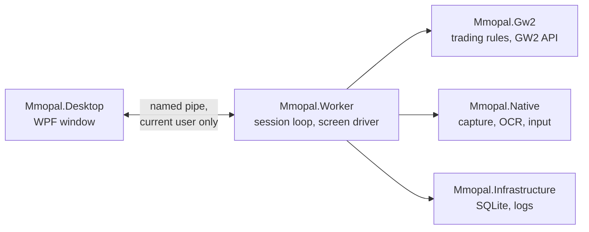

# Architecture



- **Two processes.** The window supervises the worker: one private pipe per launch, a Windows Job Object and
  `--parent-pid`, so the worker never outlives the window.
- **Rules have no UI.** `TradingCycleController` depends only on `IGw2MarketReader` and `ITradingActionExecutor`, so the
  same decisions run on replay data, Dry run, Observe and Live.
- **One place sends input:** `Gw2TradingPostUiDriver` through `Win32InputController`, in Live mode while **Arm live
  input** is on. Tests use fakes.
- **Reading the screen:** GDI capture → OpenCV template match (`assets/templates/tradingpost`, 1024×768) → digit shapes
  for prices → Windows OCR for names. Prices, orders, wallet and bags come from the official API.

Folders and files are listed in [CLAUDE.md](../CLAUDE.md).

## Replay and recording

The worker's `start` command takes a JSON payload; the window builds it from the Session page.

| Field | Meaning |
| --- | --- |
| `source` | `replay` (default) or `screen` |
| `candidates` / `candidatesPath` | Shopping list inline, or a JSON/CSV file |
| `blacklist` / `blacklistPath` | Names or `prefix *` |
| `transactions`, `balance`, `policy` | Inline market state for replay |
| `fixturePath` | JSONL recording to replay (timestamps are moved to now) |
| `recordPath`, `captureFrames`, `captureDirectory` | Record observations, optionally with raw BGRA32 frames |
| `templateRoot`, `visibleItemName` | Screen-read overrides |

```json
{
  "candidates": [{ "itemName": "Replay Profit", "quantity": 2, "buyPriceCopper": 10000, "sellPriceCopper": 20000 }],
  "blacklist": ["Unwanted *"],
  "transactions": [],
  "balance": { "copper": 1000000 },
  "policy": { "minimumProfitPercentage": 50 }
}
```
